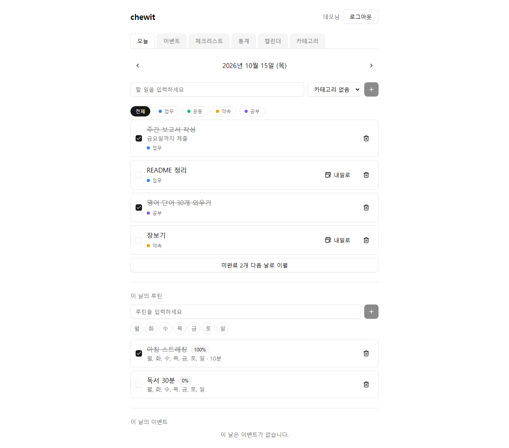
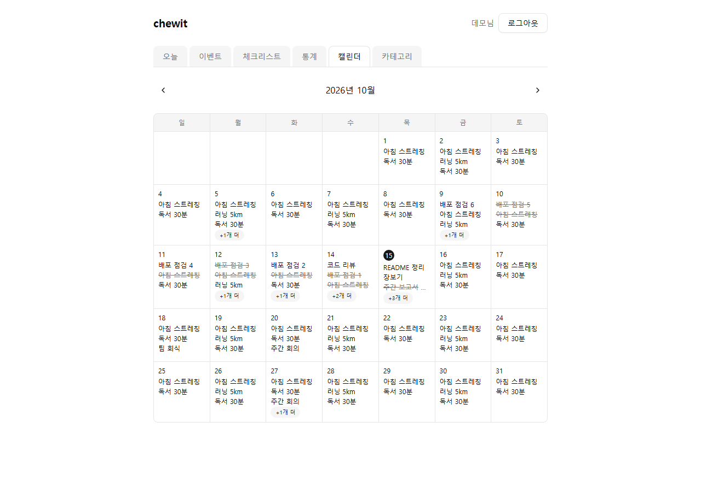
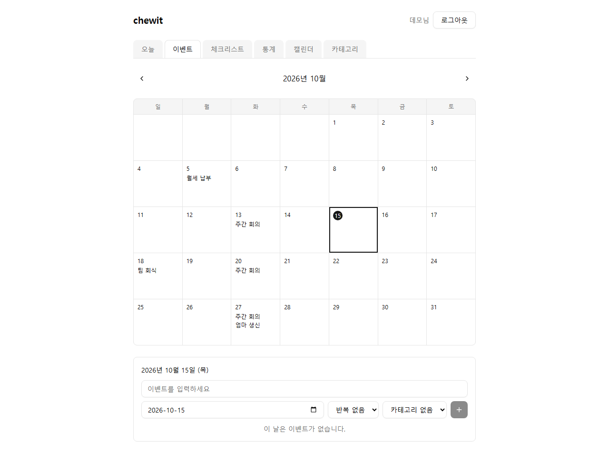
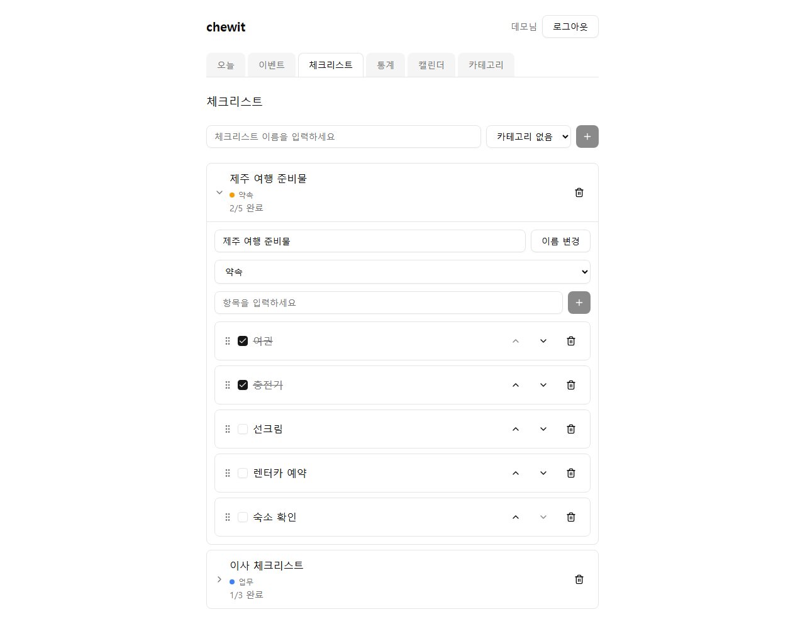
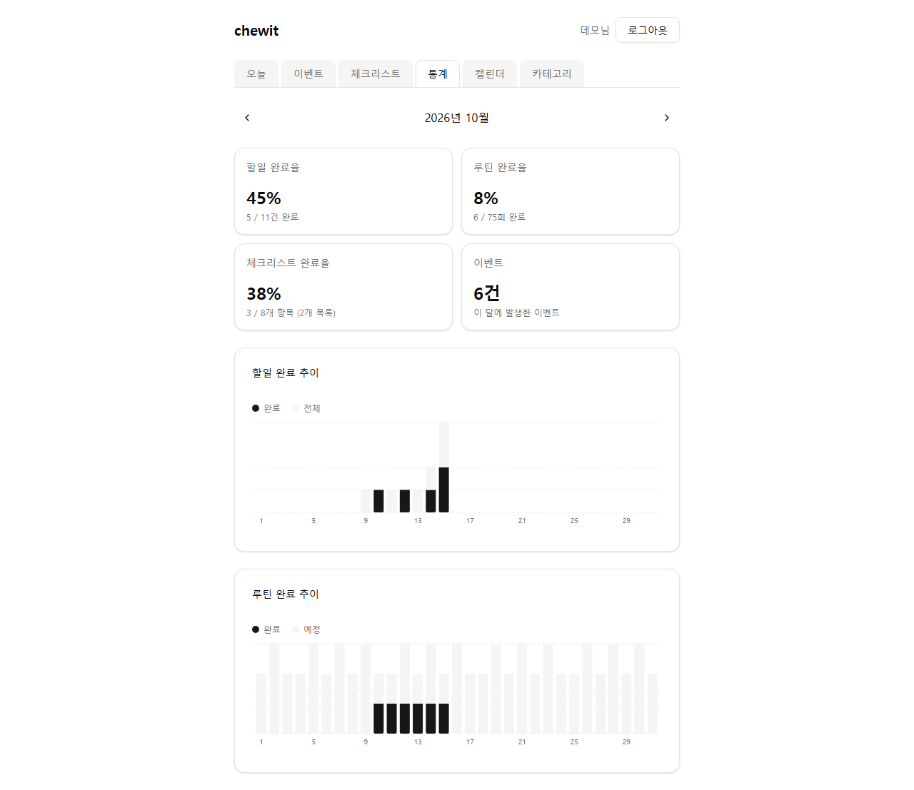
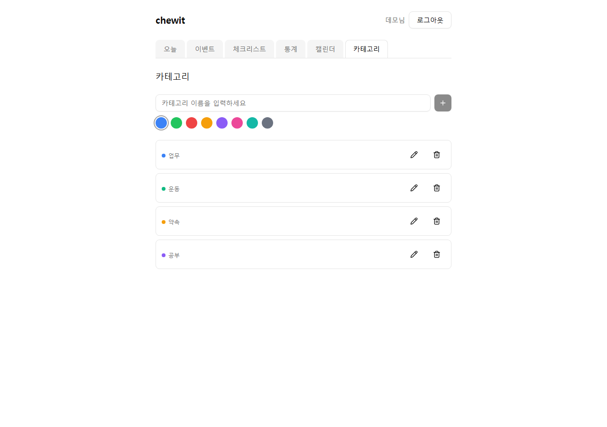
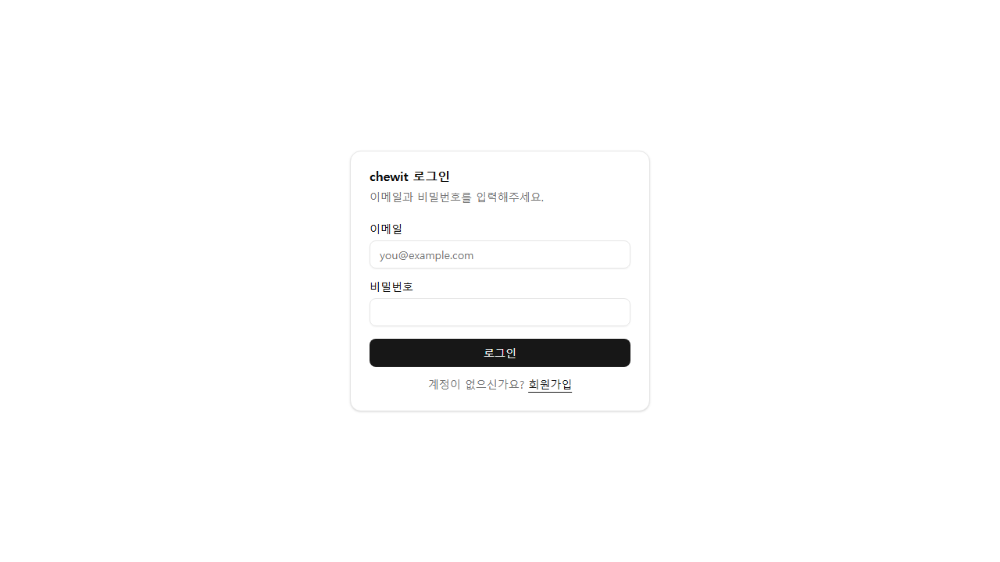

# chewit

할 일 · 루틴 · 이벤트 · 체크리스트 · 캘린더를 한곳에서 관리하는 플래너 앱입니다.
백엔드(Spring Boot)와 프론트엔드(React SPA)가 분리된 모노레포 토이 프로젝트입니다.

## 주요 기능

| 기능 | 설명 |
| --- | --- |
| 인증 | 이메일/비밀번호 회원가입·로그인, JWT 기반 인증 (멀티 유저) |
| Task | 날짜별 일일 할 일 CRUD, 완료 토글, **미완료 Task 다음 날로 이월** |
| Routine | 요일 반복 루틴 정의 + 날짜별 완료 기록, 루틴 완료율 배지 |
| Event | 반복 가능한 이벤트 (NONE / WEEKLY / MONTHLY / YEARLY), 월별 조회, 반복 이벤트의 **특정 회차만 수정/삭제** |
| Checklist | 체크리스트와 아이템 관리, 드래그 앤 드롭 정렬 |
| Category | Task / Event / Checklist에 붙일 수 있는 색상 카테고리 |
| Calendar | Task · Routine · Event를 한 화면에 모은 월간 캘린더 |
| Stats | 월간 통계 및 차트 |

> 캘린더 연동(Apple/Google OAuth)과 구독/결제는 범위에서 제외했습니다.

## 화면

| 오늘 (Task · Routine · Event) | 월간 캘린더 |
| --- | --- |
|  |  |

| 이벤트 | 체크리스트 |
| --- | --- |
|  |  |

| 월간 통계 | 카테고리 |
| --- | --- |
|  |  |

| 로그인 |
| --- |
|  |

## 기술 스택

**Backend** (`backend/`)
- Java 17, Spring Boot 4.1.0 (Gradle)
- Spring Web MVC, Spring Data JPA, Spring Security, Validation
- PostgreSQL, JWT (JJWT 0.12.6)
- springdoc-openapi 3.1.0 (Swagger UI)
- 테스트: JUnit 5, Mockito, `@WebMvcTest`

**Frontend** (`frontend/`)
- React 19, TypeScript, Vite
- React Router, TanStack Query, react-hook-form + zod
- Tailwind CSS v4, shadcn/ui, Recharts
- 테스트: Vitest, Testing Library

## 프로젝트 구조

```
notecircle/
├─ backend/                        # Spring Boot API (package: com.chewworld.chewit)
│  └─ src/main/java/.../
│     ├─ controller/               # REST 컨트롤러
│     ├─ service/                  # 인터페이스 + Impl
│     ├─ repository/               # Spring Data JPA
│     ├─ entity/  dto/             # 엔티티 / 요청·응답 DTO
│     ├─ security/  config/        # JWT 필터, SecurityConfig
│     └─ exception/                # 커스텀 예외 + GlobalExceptionHandler
└─ frontend/                       # React SPA
   └─ src/
      ├─ features/                 # 도메인별 api / hooks / types / 컴포넌트
      ├─ routes/                   # 페이지
      ├─ components/               # 공용 + shadcn/ui 컴포넌트
      └─ lib/                      # axios 인스턴스, 날짜 유틸 등
```

## 시작하기

### 사전 요구사항

- JDK 17
- Node.js (npm)
- PostgreSQL (로컬 실행, 기본 포트 5432)

### 1. 데이터베이스 준비

기본 설정은 DB 이름, 사용자, 비밀번호가 모두 `chewit`입니다.

```sql
CREATE USER chewit WITH PASSWORD 'chewit';
CREATE DATABASE chewit OWNER chewit;
```

테이블은 `spring.jpa.hibernate.ddl-auto=update`로 서버 기동 시 자동 생성됩니다.

### 2. 백엔드 실행

```bash
cd backend
./gradlew bootRun        # Windows: gradlew.bat bootRun
```

- API 서버: http://localhost:8080
- Swagger UI: http://localhost:8080/swagger-ui/index.html

### 3. 프론트엔드 실행

```bash
cd frontend
npm install
npm run dev
```

- 개발 서버: http://localhost:5173
- Vite가 `/api` 요청을 `localhost:8080`으로 프록시하므로 별도의 CORS 설정이 필요 없습니다.

## 환경 변수

백엔드는 아래 환경 변수로 설정을 덮어쓸 수 있습니다. (`application.properties`)

| 변수 | 기본값 | 설명 |
| --- | --- | --- |
| `DB_NAME` | `chewit` | 데이터베이스 이름 |
| `DB_USERNAME` | `chewit` | DB 사용자 |
| `DB_PASSWORD` | `chewit` | DB 비밀번호 |
| `JWT_SECRET` | 개발용 고정 문자열 | JWT 서명 키 — **운영 환경에서는 반드시 변경** |
| `JWT_EXPIRATION_MS` | `86400000` (24시간) | 토큰 만료 시간 |

## 테스트

```bash
# 백엔드 (Service 단위 테스트 + Controller 통합 테스트)
cd backend
./gradlew test

# 프론트엔드
cd frontend
npm test
```

## API 개요

모든 `/api/**` 요청은 `/api/auth/signup`, `/api/auth/login`을 제외하고 `Authorization: Bearer <token>` 헤더가 필요합니다.
전체 명세는 Swagger UI에서 확인할 수 있습니다.

| 리소스 | 엔드포인트 |
| --- | --- |
| Auth | `POST /api/auth/signup` · `POST /api/auth/login` · `GET /api/auth/me` |
| Task | `GET /api/tasks?date=` · `POST` · `PATCH /{id}` · `PATCH /{id}/toggle` · `DELETE /{id}` · `POST /carry-over` |
| Routine | `GET /api/routines` · `GET /today?date=` · `POST` · `PATCH /{id}` · `PATCH /{id}/toggle?date=` · `DELETE /{id}` |
| Event | `GET /api/events?month=YYYY-MM` · `POST` · `PATCH /{id}` · `DELETE /{id}` · `PATCH /{id}/occurrences/{date}` · `DELETE /{id}/occurrences/{date}` |
| Checklist | `GET /api/checklists` · `POST` · `PATCH /{id}` · `DELETE /{id}` · `POST /{id}/items` · `PATCH /{id}/items/{itemId}` · `PATCH /{id}/items/{itemId}/toggle` · `PATCH /{id}/items/reorder` · `DELETE /{id}/items/{itemId}` |
| Category | `GET /api/categories` · `POST` · `PATCH /{id}` · `DELETE /{id}` |
| Calendar | `GET /api/calendar?month=YYYY-MM` |
| Stats | `GET /api/stats/monthly?month=YYYY-MM` (`month` 생략 시 현재 월) |

## 설계 메모

- **계층 구조**: Controller → Service(인터페이스 + Impl) → Repository. 엔티티는 DTO(record)로만 노출합니다.
- **소유권 검증**: 모든 도메인 데이터는 User와 연관되며, `findByIdAndUser_Id` 패턴으로 다른 사용자의 데이터 접근 시 404를 반환합니다.
- **Routine**: 루틴 정의(`Routine`)와 완료 기록(`RoutineCompletion`, 행이 존재하면 완료)을 분리했습니다.
- **Event 반복**: occurrence를 DB에 저장하지 않고 조회 시점에 서비스 레이어에서 계산합니다. 월말 날짜는 해당 월의 말일로 보정합니다. 반복 이벤트를 `DELETE /api/events/{id}`로 삭제하면 시리즈 전체가 삭제되고, 특정 회차만 삭제/수정하려면 `.../occurrences/{date}`를 사용합니다. 회차 단위 변경은 `event_occurrence_overrides` 테이블에 저장되며(삭제=skipped, 수정=title 등 override), 시리즈의 날짜/반복 규칙이 바뀌면 해당 이벤트의 override는 초기화됩니다. 응답의 `overridden` 필드로 수정된 회차인지 구분합니다.
- **예외 처리**: 새 예외 타입을 추가하면 `GlobalExceptionHandler`에도 핸들러를 추가해야 합니다. 누락 시 Spring의 `/error` forward가 인증 필터를 거치지 않아 401로 덮어써질 수 있습니다.
- **오류 응답 형식**: 모든 오류는 `{status, message, timestamp}` JSON으로 응답합니다(필터 체인의 401/403도 동일). 토큰이 없거나 유효하지 않으면 401, 없는 경로는 404, 메서드가 맞지 않으면 405(`Allow` 헤더 포함)입니다.
